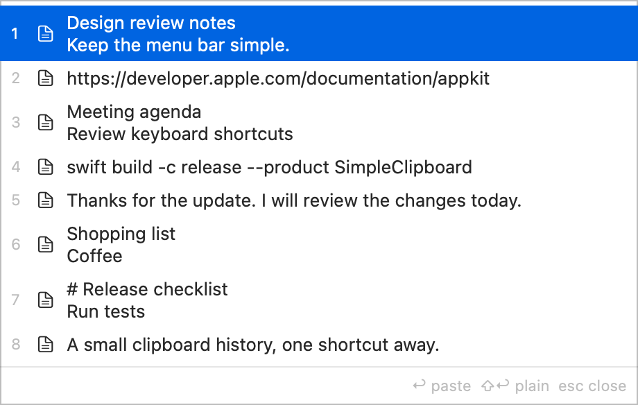
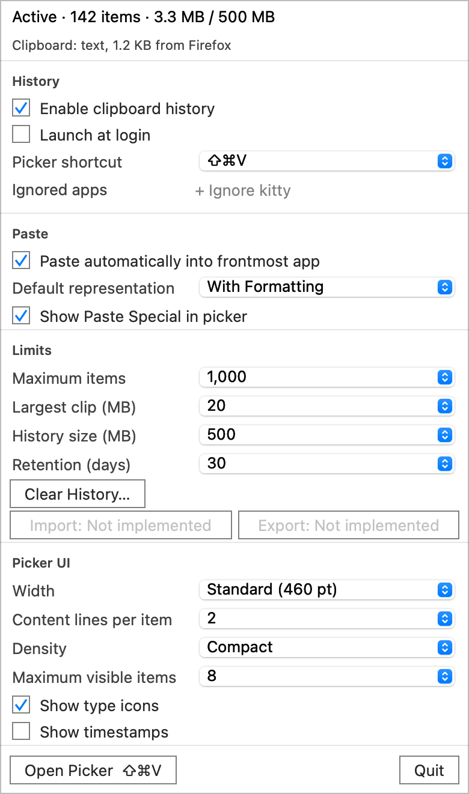

# Simple Clipboard

A small, keyboard-first clipboard history app for macOS 13 or later. It lives in the menu bar, saves copies on disk, and pastes earlier clips into the app you are using.

## Picker

Press **Shift-Command-V**, then type to find a clip. There is no search box to focus.



- **Up / Down:** select a clip.
- **Return:** paste it, or restore it to the clipboard when automatic paste is off.
- **Shift-Return:** use the alternate representation: plain text by default, or formatting when the default is plain text.
- **Command-Return:** open Paste Special text filters, when enabled.
- **Command-1 through Command-9:** recall a numbered clip.
- **Tab:** preview the selected clip.
- **Escape:** dismiss the preview, clear a search, or close the picker. In Paste Special, return to the clips first.

The picker shows actual lines of copied content. Its height follows the results, bounded by your visible-item setting and display. Resize its edges or corners to change the width or height cap.

## Control panel

Click the clipboard icon in the menu bar. The icon stays icon-only; history count and storage usage appear inside the panel.



- **History:** pause capture, launch at login, change the picker shortcut, and exclude apps.
- **Paste:** automatic paste or clipboard-only recall, formatting or plain text, and Paste Special.
- **Limits:** item count, total stored content size, retention age, and maximum size of one copy.
- **Picker UI:** width, content lines, density, visible items, type icons, and timestamps.

Settings apply immediately and persist across launches. Clear History asks for confirmation. **Import and Export are visible but not implemented.**

Screenshots use synthetic clipboard content rendered by the app's test harnesses.

## Build and run

Install the Xcode Command Line Tools. A full Xcode installation is not required.

```bash
bash bundle.sh
open SimpleClipboard.app
```

Automatic paste requires **System Settings > Privacy & Security > Accessibility** permission for Simple Clipboard. Without it, recall still restores the clipboard; press Command-V yourself. Some apps may reject simulated paste or particular clipboard representations.

### Stable local signing

To keep a consistent signing identity across rebuilds, create a local identity once per machine:

```bash
bash tools/create-signing-identity.sh
bash bundle.sh
```

This adds a self-signed certificate and private key named `evadnoob Local Code Signing` to your login keychain. When macOS asks whether `codesign` may use the key, choose **Always Allow**. The certificate can appear as `CSSMERR_TP_NOT_TRUSTED`; it does not need system trust for local signing.

`bundle.sh` uses that identity, or the value of `SIGNING_IDENTITY`. If the identity is missing, it warns and signs ad-hoc. Switching signing identities can require granting Accessibility again. Permission persistence across rebuilds still needs live validation.

## Privacy and storage

Copies stay in `~/Library/Application Support/simple-clipboard/`, in SQLite and content-addressed blob files. Set `SIMPLE_CLIPBOARD_DATA` to use another directory. No cloud service is required.

Copies from excluded apps, copies marked concealed or transient, and oversized copies are skipped. These checks are not a guarantee that all sensitive content is excluded. The recorded source app is the app in front when the copy is detected. Copying identical content moves its existing entry to the top.

Old history is removed according to count, age, and total-content-size limits. Total content size is not the same as disk usage: the database, search index, and other storage overhead also occupy space. Previews inspect at most the first 64 KiB of text; full stored clipboard representations are unchanged.

## Development

```bash
bash tools/run-tests.sh
```

Tests use synthetic data. Offscreen rendering does not verify live focus, paste delivery, VoiceOver interaction, launch at login, or mouse resizing. Input methods that compose characters are not supported yet.
